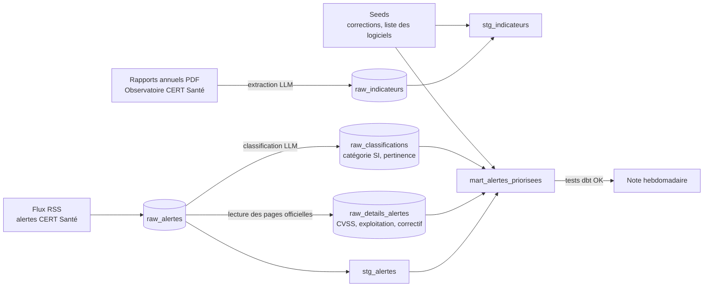

# Veille cyber santé : incidents et vulnérabilités dans les établissements de santé français

Venant du milieu du soin, j'ai plusieurs fois travaillé en mode dégradé, pendant des pannes informatiques touchant tout un hôpital. Ce projet part d'une question simple : à quoi ressemble la menace cyber qui pèse aujourd'hui sur les établissements de santé français, et comment aider un hôpital à prioriser les alertes qu'il reçoit ?

Il réunit deux volets :

1. **Un historique des incidents** déclarés au CERT Santé depuis 2020, reconstruit à partir des rapports annuels officiels.
2. **Une veille hebdomadaire automatisée** sur les alertes de vulnérabilités publiées par le CERT Santé, priorisées pour un établissement de santé et résumées dans une note lisible par une direction.

## Architecture

**Stack** : BigQuery, dbt Core, Python, API Gemini. Coût de fonctionnement : 0 €.

## Modélisation

| Couche | Modèle | Grain |
|---|---|---|
| Staging | `stg_indicateurs` | une année × un indicateur × une dimension × une modalité |
| Staging | `stg_alertes` | une alerte, dédoublonnée entre les ingestions |
| Mart | `mart_alertes_priorisees` | une alerte enrichie, classée et scorée |

Trois seeds portent les décisions humaines, versionnées et traçables :
- `corrections_manuelles` : les erreurs détectées dans les rapports officiels, avec la preuve de chaque correction ;
- `saisie_manuelle` : les chiffres clés publiés par l'ANS, en attendant leur extraction ;
- `logiciels_sante_france` : les logiciels réellement répandus dans les établissements français, pour corriger la pertinence estimée par le modèle.

14 tests dbt contrôlent le grain, les valeurs manquantes et les valeurs autorisées. La note hebdomadaire n'est produite que si tous les tests passent.

## Choix de conception

**Les faits viennent de la source, le LLM ne juge que ce qu'il peut voir.** Une première version laissait le modèle estimer la gravité des failles à partir d'un résumé tronqué. Comparée au score CVSS officiel, cette estimation était juste dans 17 % des cas seulement, et sous-estimée dans 74 % des cas. La gravité, l'exploitation et la disponibilité d'un correctif sont donc désormais lues directement sur la page officielle de chaque alerte. Le modèle ne sert plus qu'à ce qu'il fait bien : rattacher l'alerte à une brique du système d'information hospitalier et juger sa pertinence.

**Priorité à la source primaire.** Un même chiffre apparaît souvent dans plusieurs rapports. Pour chaque année, le modèle retient le chiffre publié dans le rapport de cette année-là, et ne recourt aux rapports suivants qu'à défaut.

**Un score de priorité lisible.** Pertinence pour un hôpital (1 à 3) × gravité CVSS (1 à 4), + 5 si la faille est déjà exploitée, + 2 si une preuve de concept est publique, + 2 en l'absence de correctif. Une faille moyenne déjà exploitée passe ainsi devant une faille critique encore théorique.

**Une rédaction encadrée.** Les chiffres de la note sont calculés en Python, pas par le modèle. Le prompt interdit de transformer une vulnérabilité en attaque réussie ou d'ajouter un qualificatif absent des données. Chaque affirmation de la note a été vérifiée dans les données.

## Résultats

**Incidents déclarés au CERT Santé**

| 2020 | 2021 | 2022 | 2023 | 2024 | 2025 |
|---|---|---|---|---|---|
| 369 | 733 | 592 | 581 | 749 | 764 |

**Enseignements**
- Les déclarations ont doublé entre 2020 et 2025, en partie parce que les établissements déclarent mieux.
- Deux rappels « pour mémoire » des rapports officiels contredisent les chiffres publiés à l'origine. Pour 2020, le rapport 2022 indique 396 incidents, alors que la somme mensuelle de son propre graphique donne 369 : la hausse annoncée de 50 % était en réalité de 60 %.
- Sur un mois d'alertes, aucune ne concernait un logiciel de dossier patient courant en France. Les priorités portent d'abord sur les accès à distance (VPN), la messagerie, les pare-feu et les sauvegardes.

Un exemple de note hebdomadaire est disponible dans le dossier [`syntheses/`](syntheses/).

## Limites

- Les incidents analysés sont des incidents **déclarés**, pas l'ensemble des incidents réels.
- Le flux RSS ne couvre qu'environ un mois d'alertes : l'historique de la veille se construit au fil des exécutions.
- Les chiffres extraits du texte des rapports n'incluent pas ceux qui figurent uniquement dans les graphiques.
- La liste des logiciels répandus en France est une première version, construite à partir d'études de marché publiques, et reste à enrichir.

## Sources

- [Observatoire des incidents de sécurité des SI de santé, ANS / CERT Santé](https://esante.gouv.fr/produits-services/cybersecurite/cert-sante/l-observatoire-des-incidents)
- [Alertes et vulnérabilités du CERT Santé](https://cyberveille.esante.gouv.fr/alertes-et-vulnerabilites)

## Prochaines étapes

- Exécution hebdomadaire automatisée de la veille.
- Extension de la liste des logiciels répandus en établissement de santé.
- Préparation de la certification CompTIA Security+, pour approfondir la sécurité des pipelines de données de santé.
